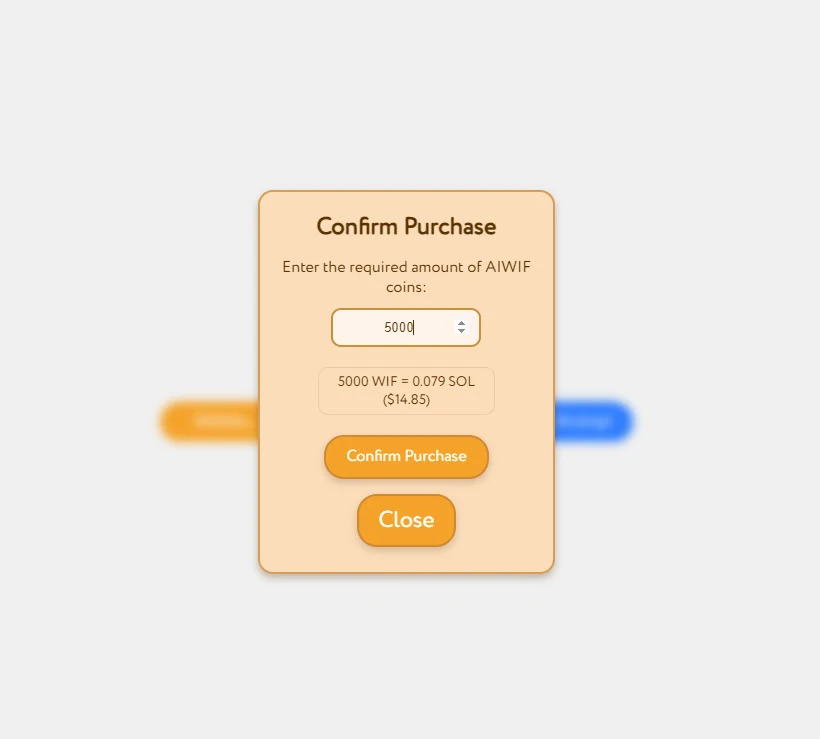

# AI dogwifhat - приложение токена на Solana

**Автор проекта:** [Евгений Толмачев](https://github.com/EvgenyET) · [Страница проекта в портфолио](https://evgeny-dev.pro/project/aiwif_project/aiwif.html)

Веб-приложение с Phantom, запросом airdrop и формой покупки SPL-токена.

## Мой вклад

Сделал интерфейс подключения Phantom и форму покупки токена, которая проверяет количество перед подтверждением. Связал клиентскую часть с сервером на Express и сохранением сведений о подключениях в MongoDB.

## Интерфейс

**Главный экран с действиями для кошелька и токена**

**Форма подтверждения покупки**

## Как это работает

Пользователь подключает кошелёк, видит его адрес и выбирает действие с токеном. Интерфейс покупки рассчитывает параметры операции, а состояние подключения сохраняется между посещениями.

## Возможности

- Подключение и отключение Phantom.
- Форма покупки с проверкой введённого количества.
- Запрос airdrop и отображение результата операции.

## Технологии

Solana, Phantom Wallet, @solana/web3.js, @solana/spl-token, SPL Token, JavaScript (ES6), Webpack 5, Babel, Node.js, Express, MongoDB.
