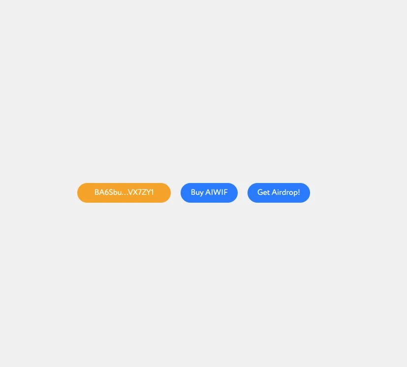

# AI dogwifhat - приложение токена на Solana

Автор проекта - **Евгений Толмачев**. [Профиль GitHub](https://github.com/EvgenyET) · [Проект в портфолио](https://evgeny-dev.pro/project/aiwif_project/aiwif.html)

Веб-приложение токена AI dogwifhat на Solana. Подключение Phantom, покупка SPL-токена и airdrop, расчёт стоимости и сохранение данных кошелька в MongoDB.

## Задача проекта

Проект охватывает клиентский интерфейс Web3-приложения, взаимодействие с Phantom и серверный API. Существенная часть работы - согласовать состояние кошелька, проверку параметров операции и обратную связь для пользователя при асинхронных запросах.

## Мой вклад

Разработал подключение и отключение Phantom, форму покупки и сценарий airdrop. Реализовал проверку введённого количества, пересчёт стоимости и сообщения о ходе операции. Подготовил Express API, сохранение данных кошельков в MongoDB и обновление курса из внешнего источника.

## Интерфейс

**Главный экран с действиями для кошелька и токена**

**Форма подтверждения покупки**

## Как работает приложение

AI dogwifhat объединяет подключение Solana-кошелька и действия с SPL-токеном в одном браузерном интерфейсе. Пользователь подключает Phantom, задаёт количество токенов и проверяет сумму перед подтверждением покупки. Для раздачи предусмотрен отдельный сценарий airdrop. Интерфейс показывает состояние операции и актуальный курс SOL, а сервер сохраняет сведения о подключённых кошельках.

## Возможности

- Подключение Phantom с отображением адреса и обновлением доступных действий.
- Ввод количества SPL-токенов и предварительный расчёт стоимости покупки.
- Окно подтверждения и последовательные сообщения о выполнении операции.
- Отдельный запрос airdrop и отображение его результата.
- Сохранение данных о кошельках в MongoDB через Express API.

## Техническое устройство

### Кошелёк

Модуль подключения получает публичный адрес Phantom, обновляет элементы управления и сохраняет состояние подключения между посещениями страницы.

### Операции с токеном

У формы покупки и запроса airdrop отдельные обработчики. Форма проверяет введённое количество до подтверждения. Для операций с SPL-токеном используются его точность и связанный токенный счёт.

### API

Express обрабатывает обращения клиента. Сведения о кошельках сохраняются в MongoDB, а курс SOL обновляется по данным внешнего API.

## Технологии

| Технология | Роль в проекте |
| --- | --- |
| Solana и SPL Token | Работа с адресами и токенными операциями. |
| Express и MongoDB | Обработка запросов и хранение сведений о кошельках. |
| Webpack | Сборка браузерного приложения. |

## Состояние показанной версии

- Для выполнения операций нужны доступный Solana RPC, настроенная серверная часть и подключённый кошелёк. Видеозапись показывает сохранённую версию приложения.

## Демонстрация

На странице портфолио доступны описание, галерея и видеодемонстрация проекта. [Открыть AI dogwifhat - приложение токена на Solana](https://evgeny-dev.pro/project/aiwif_project/aiwif.html).
